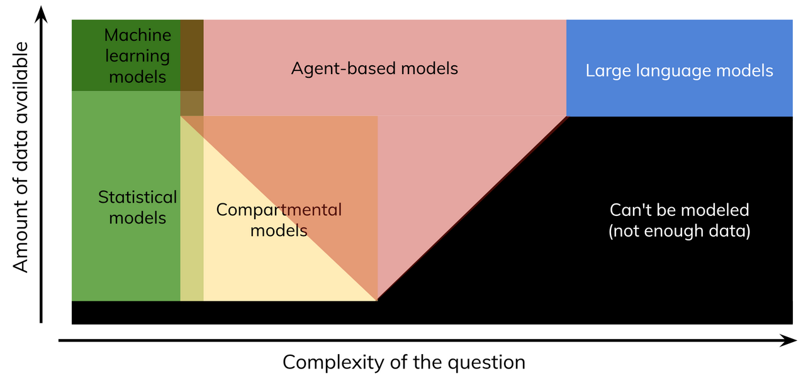

## Introduction

Starsim is a framework for modeling the spread of diseases: as deterministic or stochastic compartmental models, as metapopulation models across places, or as agents with dynamic transmission networks. A disease is written as its states and the transitions between them, as in a textbook model, and the same model then runs in any of these ways. Starsim also models several diseases at once and how they interact, non-infectious diseases, pregnancy and birth, interventions and how they are delivered, and fitting to data.

Starsim is available for both Python and R (see [R-Starsim](https://r.starsim.org)), and is fully open-source under the MIT license.

## Kinds of model and tool

Mechanistic models of transmission differ in how they represent the population. **Deterministic compartmental models** follow the number of people in each compartment (susceptible, infectious, recovered, often stratified by age, sex, or place) as an ordinary differential equation (ODE): fast, smooth, and easy to fit, but with no chance in them. **Stochastic compartmental models** move whole numbers of people between the same compartments at random (a chain binomial, or the Gillespie algorithm), which captures fade-out and the variation between runs. **Metapopulation models** link compartmental models in many places by movement. **Network and agent-based models** (ABMs) follow individuals, with their own states, contacts, and histories: the most flexible, and the most costly to run and to check. The choice depends on the question: an ODE for the expected course of a large epidemic, a stochastic or agent-based model where chance, heterogeneity, or individual histories matter. For example, "Are vaccinated people less likely to be infected?" is a question for a statistical model; "What will prevalence be in 5 years with 100% vaccine uptake?" for a compartmental model; and "What will prevalence be in 5 years given realistic screening and vaccine coverage?" for agents.



Tools differ as much in how a model is written: by hand in a general-purpose language (NumPy, deSolve), in a model language (odin), in configuration files (flepiMoP, Atomica), as a library of compartmental models (summer2, epydemix, MEmilio, SimInf), as a network or agent-based framework (EpiModel, LASER, EMOD, Mesa), or with statistical tools that fit mechanistic models to data (pomp, Stan). Models from many of these can be read into Starsim, and Starsim models written out to several (see [Import and export](building_import.qmd)); the [lingua_franca](https://github.com/starsimhub/lingua_franca) repo has a model from each written both ways, with how their results and speed compare. If you are coming from Starsim 3, see the [migration guide](../migration/v3_v4.md).

## Where Starsim fits

Starsim's distinctive feature is that one model runs in more than one of these ways. A disease declared as states and transitions (`S >> I @ beta*I`; see [Writing models](building_writing.qmd)) is data that Starsim can read, so the same declaration runs as an ODE, as a stochastic compartmental model, or as agents, in one place or across several as a metapopulation. Starsim runs it as compartments unless something in it needs individuals, such as a contact network, and says which it chose; one argument overrides it (see [Solvers and backends](running_solvers.qmd)). So a model can start as an ODE, be fitted fast, and then run as agents to add a network or an intervention that targets individuals, without being written twice. What the declaration can't express is added by a module written as code ([Custom modules](building_modules.qmd)). The [conceptual overview](intro_concepts.qmd) explains how this works.

Starsim's design follows two principles: common tasks (defining parameters, running a sim, plotting results) should be simple, and custom tasks (a new vaccine, a new disease, a calibration function of your own) can't always be simple, but should still be possible. If you're modeling a complicated disease, some of that complexity is irreducible: Starsim's job is to help where it can, then get out of the way and let you write your code. See [Architecture](architecture_index.qmd#the-idea-and-the-principles) for the full set.

## Why use a framework?

A disease model is a few equations, so why not write them in Python or R yourself? For many models that is the right answer.

### When your own code is enough

A single deterministic SIR model is about 15 lines of Python with SciPy. Here is the measles outbreak used throughout these docs, with β = 1.9 per day and 8 days infectious, in a town of 100,000 people:

```{python}
import numpy as np
from scipy.integrate import solve_ivp

beta, gamma, N = 1.9, 1/8, 100_000

def deriv(t, y):
    S, I, R = y
    infection = beta*S*I/N
    recovery = gamma*I
    return [-infection, infection - recovery, recovery]

days = np.arange(51)
out = solve_ivp(deriv, [0, 50], [N - 100, 100, 0], t_eval=days, rtol=1e-8)
print('Most infectious at once:', round(out.y[1].max()))
```

And here is the same model in Starsim:

::: {.panel-tabset group="language"}
## Python

```{python}
import starsim as ss

S, I, R = ss.states('S I R')
measles = ss.Disease(S >> I @ 1.9*I, I >> R @ ss.days(8), init_n=dict(I=100))
sim = ss.Sim(measles, total_pop=N, stop=ss.days(50), verbose=0).run()
print('Most infectious at once:', round(sim.results.measles.I.max()))
```

## R

```r
library(starsim)

N <- 100000
states("S I R")
measles <- Disease(Transition(S, I, rate = 1.9 * I), Transition(I, R, dur = days(8)), init_n = list(I = 100))
sim <- Sim(measles, total_pop = N, stop = days(50), verbose = 0)$run()
cat("Most infectious at once:", round(max(sim$results$measles$I$values)), "\n")
```

## Explicit

```{python}
S, I, R = ss.State(name='S'), ss.State(name='I'), ss.State(name='R')
measles = ss.Disease(
    transitions = [
        ss.Transition(source=S, dest=I, rate=ss.perday(1.9)*I, name='infection'),       # β S I / N
        ss.Transition(source=I, dest=R, dur=ss.expon(mean=ss.days(8)), name='recovery'), # γ I, with γ = 1/8
    ],
    init_n = dict(I=100), # 100 infectious at the start, and the rest susceptible
    name   = 'measles',
)
sim = ss.Sim(
    diseases  = measles,
    networks  = ss.contacts(1), # Everyone mixes with everyone, with one contact per person per day
    total_pop = N,
    start     = ss.days(0),
    stop      = ss.days(50),
    dt        = ss.days(1),
    unit      = 'day',
    solver    = 'ode',
    verbose   = 0,
)
sim.run()
print('Most infectious at once:', round(sim.results.measles.I.max()))
```
:::

The two agree to within a couple of people. If this is the whole job (one model, run deterministically, read by you), the plain version is fine, as is deSolve or odin in R; Starsim is not faster than good code of your own for a model like this.

### Where your own code starts to strain

A model rarely stays that small. These are the changes that tend to turn a short script into a long one, and what each takes in Starsim:

| The model grows to need | In code of your own | In Starsim |
|---|---|---|
| Age groups with a contact matrix | Rewrite every equation as a vector, and the force of infection as a matrix product | `sim.stratify(age=[0, 5, 15, 65])` and `ss.contacts('Kenya')` ([Stratification](building_stratification.qmd)) |
| A latent period that isn't exponential | Add the right number of stages, and keep their rates consistent | `ss.erlang(k=4, mean=ss.days(10))` ([Diseases](building_diseases.qmd#durations)) |
| A stochastic version, or agents | A second model, written and tested again | `solver='binomial'`, or `n_agents=` ([Solvers](running_solvers.qmd)) |
| Rates in different units (daily transmission, yearly births) | Convert each by hand, and again whenever the step changes | Each value carries its unit (`ss.peryear(0.02)`) ([Time](building_time.qmd)) |
| Vaccination campaigns and routine immunization | Code for eligibility, coverage, timing, and waning | `ss.vaccinate()` with a product ([Products](interventions_products.qmd)) |
| Reported cases, with delays and under-reporting | A second set of results worked out from the first | `ss.outcome(0.5*onset, delay=ss.days(4))` ([Outcomes](building_outcomes.qmd)) |
| Fitting to data | A likelihood, an optimizer or sampler, and code tying parameters to the model | `ss.par(bounds=...)` and `sim.fit()` ([Fitting](calibration_fitting.qmd)) |
| Comparing scenarios fairly | Seeds managed so the scenarios differ by the intervention, not by chance | Common random numbers, on by default ([Random numbers](mechanics_random.qmd)) |
| A second disease that interacts with the first | Combined states, or two models coupled step by step | Two diseases in one sim, and `ss.modify()` between them ([Connectors](interventions_connectors.qmd)) |
| Someone else checking the model | Reading the code | `describe()`, `equations()`, `diagram()`, and `R0()` ([Writing models](building_writing.qmd)) |

None of these is hard on its own, but each touches the others (age groups change the force of infection, which changes what the vaccine acts on, which changes what the fit compares with data), and the bookkeeping is where the mistakes are. A rough guide: once a script is past about 100 lines, or needs calibration, more than one unit of time, or both a deterministic and a stochastic version, a framework is likely to save time.

Speed matters less for one small model than for many runs (fitting, uncertainty, scenario sweeps), for agents, and for large populations. Starsim runs compartmental models in compiled code, at the same cost whatever the size of the population, and steps agents with compiled passes over arrays; see [Speed and scale](running_performance.qmd).

### Problems that are easy to miss

The hardest mistakes in a model are the ones that give plausible numbers. Each of the problems below was found while building Starsim, sometimes in Starsim itself, and each is now handled and tested:

| The problem | How big it can be | What Starsim does |
|---|---|---|
| **Competing exits drawn one after the other.** Deaths are drawn among those infectious, and then recovery among the survivors, so whichever comes first in the code gets more people | Of the order of the rates times the step | Draws who leaves a state once, from the total rate, and then which way each person goes, in proportion to the rates |
| **People infected during a step are given a whole step to recover** at their first chance, rather than the half step they have on average | An SIR with 8 days infectious, in 8-day steps: an attack rate of 7% instead of 77% (the ODE gives 80%) | People who arrive in a state during a step face half a step of its exits |
| **A step that is long for the disease.** Someone infected in a step can't infect anyone until the next one | Measles in daily steps peaks about 3 days late (see the [conceptual overview](intro_concepts.qmd#how-the-solver-is-chosen)) | Compartmental solvers take as many substeps as they need; agents get a note when the step is long, and `sim.check_dt()` measures the effect |
| **Converting a probability between periods by dividing.** An annual probability of 0.5 is not 0.5/12 a month | 0.042 a month instead of 0.056; scaling the other way gives probabilities above 1 | Probabilities, rates, and durations are typed, and converted through the rate |
| **Losing the unit of time.** A rate or duration becomes a bare number, and the unit is forgotten | A country's contact matrix, in contacts a day, used 365 times too low in a model in years | Values carry their units, and arithmetic that mixes them wrongly raises an error |
| **Scenarios that differ by chance.** With one stream of random numbers, one extra draw in a scenario changes every draw after it | Differences between scenarios that the intervention didn't cause, which need many more runs to average out | Common random numbers: each person's draws stay the same between scenarios unless the scenario changes them |
| **Compartments that go negative** when the outflows in a step are larger than the compartment | Negative numbers of people, or runs that stop | In steps that are taken whole, outflows that would take more than everyone in a compartment are scaled down together; the stochastic solvers draw no more people than there are |

Most of these errors are of the order of the rates times the step, so a model checked in daily steps can go wrong when run in weeks.

A framework is not a guarantee of correctness: the model's structure, assumptions, and evidence are still yours to get right. Starsim takes the bookkeeping off your hands, and says what it assumed (`sim.describe()` lists every value it filled in itself).

## Should I use Starsim?

Starsim suits modelers who write code (or are willing to), and is a good fit:

- If your agent-based model is too slow, inflexible, or hard to use for your questions (a single run takes 14 hours, and every year you worry that your computing grant won't be renewed).
- If you model with compartments and want to try agents without months of learning a new tool: an mpox model asked to evaluate an individually targeted intervention can run as an ODE and as agents, and the two can be compared.
- If you want to prototype a disease or network before adding it to your full model (you know and love your HIV model, but want to see what syphilis co-transmission, or a different MSM network, would do).

It may not be the best choice:

- For one run of a simple SIR or SEIR model, where plain Python or R is enough ([above](#when-your-own-code-is-enough)).
- If your team has a working model, highly specialized to its context, in another tool: the cost of switching may not be worth it. Starsim can import models from several frameworks ([Import and export](building_import.qmd)), so get in touch if this interests you.
- For networks estimated from survey data with exponential random graph models (`nodemix`, `gwesp`): EpiModel. Starsim's networks target degrees and matching.
- For the fastest agent-based runs at national scale (tens of millions of agents): LASER, which is about 4 times faster on the England and Wales model.
- For many small stochastic runs: odin and its companions, whose compiled models start slower but run faster.
- For livestock in thousands of herds driven by a register of movements: SimInf.
- For models built and used in spreadsheets, with budget optimization: Atomica.
- For a full pipeline of hub scenario projections on a cluster: flepiMoP, which has the batch jobs and post-processing Starsim lacks.
- For teaching with a graphical interface: NetLogo.
- For estimating the reproduction number or forecasting from surveillance data, or for statistical models not about transmission: EpiNow2, the Epiverse packages, Stan, or PyMC.

## Models and examples to start from

### Models built with Starsim

Models built with Starsim are kept in their own repositories:

| Model | Status | Description |
|-------|--------|------------|
| [Covasim](https://covasim.org) | Stable | COVID-19 |
| [HPVsim](https://hpvsim.org) | Stable | Human papillomavirus (HPV) and cervical cancer |
| [STIsim](https://stisim.org) / [HIVsim](https://docs.stisim.org/user_guide/hivsim.html) | Stable | Sexually transmitted infections, including HIV, bacterial vaginosis, chlamydia, gonorrhea, syphilis, and trichomoniasis |
| [TBsim](https://starsim.org/tbsim) | Stable | Tuberculosis, including malnutrition |
| [FPsim](https://fpsim.org) | Stable | Family planning and reproductive health |
| [Typhoidsim](https://github.com/starsimhub/typhoidsim) | Stable | Typhoid, including environmental transmission |
| [Rotasim](https://github.com/starsimhub/rotasim) | Beta | Rotavirus, with a focus on genetic diversity |
| [MIGHTI](https://github.com/starsimhub/mighti) | Beta | Model of Inter-Generational Health, Transmission, and Interventions (HIV and other comorbidities) |
| [PHCsim](https://github.com/starsimhub/phcsim) | Pre-release | Primary health care and health systems |
| [RVFsim](https://github.com/starsimhub/RVFSim) | Pre-release | Rift valley fever in cattle |

*(If you've developed a model and want it included in this list, please [get in touch](mailto:info@starsim.org).)*

These models are inter-compatible: an HIV-TB coinfection model can combine the HIV module from STIsim and the TB module from TBsim.

### The built-in library

Starsim also comes with a [library](library_index.qmd) of example diseases, networks, maternal-child health modules, and health economics, imported with `import starsim.library as ssl`. They are illustrative rather than validated, and meant to be copied and adapted.

The core of Starsim also includes the classic compartmental structures, `ss.SIR`, `ss.SIS`, and `ss.SEIR` (see [Diseases](building_diseases.qmd#diseases-as-classes)).

### Choosing a starting model

Start from the smallest model that represents the mechanism your question depends on. These pages are good starting points:

| Question | Starting point |
|---|---|
| How does a closed outbreak progress? | [SIR, four ways](../gallery/sir.qmd) |
| How many people are infected in the end? Will a single imported case start an epidemic? | [Checks against theory](../gallery/theory_checks.qmd) |
| Does the distribution of the latent or infectious period affect the timing? | [SEIR with a realistic infectious period](../gallery/seir_erlang.qmd) |
| How many hospital beds will be occupied, and how many people die? Does severity depend on age? | [Hospitalization and death](../gallery/hospitalization.qmd) |
| Does an environmental reservoir matter? | [Cholera with a water reservoir](../gallery/cholera.qmd) |
| Which age groups are most affected? Does closing schools help? | [Age groups and contacts](../gallery/age_contacts.qmd), [T4 – Mixing](../tutorials/t4_mixing.qmd) |
| What is the effect of vaccination? | [Vaccination as a stratification](../gallery/vaccination_strata.qmd), [T5 – Interventions and scenarios](../tutorials/t5_interventions.qmd) |
| How does infection move between towns? | [T4 – Mixing](../tutorials/t4_mixing.qmd) |
| What do surveillance data say about the parameters? | [Cases, hospitalizations, and deaths, fitted to data](../gallery/outcomes_fit.qmd), [T6 – Data and calibration](../tutorials/t6_data.qmd) |
| What drives recurring epidemics, such as those of measles? | [Measles in London](../gallery/measles_london.qmd) |
| Do individual partnerships matter? | [An STI on a sexual network](../gallery/sexual_network.qmd), [T4 – Mixing](../tutorials/t4_mixing.qmd) |

A runnable example is a starting point, not a calibrated model of a particular population.

## Further reading

- [Covasim: An agent-based model of COVID-19 dynamics and interventions](https://doi.org/10.1371/journal.pcbi.1009149): the paper on Starsim's predecessor, with a discussion of when agent-based models are worth their cost
- [CRAN Task View: Epidemiology](https://cran.r-project.org/web/views/Epidemiology.html): a curated list of R packages for epidemiology, including transmission models (EpiModel, odin, deSolve, and others)
- [Epicookbook](https://epirecip.es/epicookbook/): the same models written in many languages and tools
